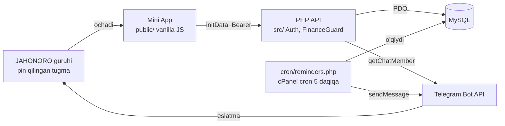

# JAHONORO — Arxitektura

Yopiq JAHONORO Telegram guruhi (1 rahbar + 8 a'zo) uchun to'ylar jadvali Mini App. Ilova guruhdagi pin qilingan tugmadan ochiladi, eslatmalarni bot guruhga o'zi yuboradi. Ko'rinish bo'yicha hamma narsa — `DESIGN.md` da.

## 1. Asosiy qarorlar

Stek: PHP 8.2 + MySQL/MariaDB + vanilla JS (build bosqichisiz), cPanel shared hosting, cron. Docker, Node.js, VPS — yo'q.

| Masala | Qaror |
| --- | --- |
| Guruhdan ochish | Telegram guruhda `web_app` inline tugmani qo'llamaydi. BotFather Direct Link (`https://t.me/<bot>/jadval`) URL tugma sifatida yuboriladi va pin qilinadi |
| Kimga ruxsat | Owner = config'dagi Telegram ID. A'zo = `users` jadvalida faol + `getChatMember` bilan **ulangan guruh** a'zosi |
| Guruhni ulash | Owner ilovadan: `t.me/<bot>?startgroup=<bir martalik kod>&admin=pin_messages` → guruh tanlanadi → `getUpdates` (webhooksiz) orqali `/start <kod>` yoki bot qo'shilgani topiladi → `settings.group_chat_id`. Begonalar qo'shsa bot chiqib ketadi |
| Sessiya | Bearer token (frontendda faqat xotirada, DB'da SHA-256 hash). Cookie va CSRF yo'q |
| Moliya ko'rinishi | Tadbirda `inherit / private / members`. `inherit` → global sozlama. Global default = private |
| Eslatma takrori | `dedupe_key` = tur + tadbir + boshlanish vaqti. Vaqt o'zgarsa yangi eslatma, eskisi bekor |
| MVP hajmi | To'ylar, kalendar, to'lovlar, eslatmalar, sozlamalar, a'zolar. Checklist, davomat, CSV — 2-versiya |
| Deploy | GitHub (private) → cPanel Git Version Control → "Update from Remote" |
| Xarita | Owner nuqtani ilova ichidagi xaritadan o'zi qo'yadi (Leaflet repoda + OpenStreetMap plitkalari). Ochish — Google Maps / Yandex. Nuqta yo'q bo'lsa nomi/manzili bilan qidiruv |
| Joylar va vaqtlar | 2 joy: to'yxona va to'y egasining uyi. Vaqtlar: Manzilda bo'lish, Nahor, Abet, Kech; asosiy vaqt = eng birinchi tadbir |
| Vaqt zonasi | Asia/Tashkent (yozgi vaqt yo'q) |

## 2. Guruhdan ochish va kirishni cheklash

Bot baribir kerak (Mini App botga tegishli, eslatmalarni bot yuboradi), lekin a'zolar botga yozmaydi.

1. BotFather: `/newbot` → masalan `@JahonoroBot`. `/newapp` → short name `jadval`, URL = `https://jahonoro.itcode.uz`.
2. Owner ilovani ochadi → Sozlamalar → **Guruhni ulash** → Telegram guruh tanlash oynasi → yopiq JAHONORO guruhi tanlanadi, bot admin bo'lib qo'shiladi (faqat "xabarlarni pin qilish"). Kod bir martalik, 30 daqiqa amal qiladi, faqat owner qo'shgani qabul qilinadi.
3. Ulanish bilan bot guruhga "📅 TOʻYLAR JADVALI" URL tugmali xabar yuboradi va pin qiladi (keyin Sozlamalardan qayta yuborish mumkin).
4. A'zo tugmani bosadi → Mini App Telegram ichida ochiladi.

Havolani boshqa joyga tashlash mumkin, shuning uchun himoya serverda:

- initData imzosi bot token bilan tekshiriladi.
- `user.id == OWNER_TELEGRAM_ID` → owner.
- Aks holda `users` da `status=active` va `getChatMember(GROUP_CHAT_ID, user_id)` holati `member / administrator / creator`. Natija 10 daqiqa keshlanadi.
- Guruhdan chiqarilgan odam keyingi tekshiruvda bloklanadi.
- Guruh a'zosi birinchi marta ochsa `status=pending` bo'lib yoziladi, owner tasdiqlaydi.
- Telegram tashqarisida — "Faqat Telegram orqali" sahifasi.

Guruh ID'si qo'lda olinmaydi — ulash oqimi uni o'zi saqlaydi (`config.php` dagi `GROUP_CHAT_ID` faqat zaxira). Webhook ishlatilmaydi: yangilanishlar `getUpdates` bilan ulash paytida va har cron'da o'qiladi (guruh supergroup'ga aylansa yangi ID ham shu yo'l bilan saqlanadi). Guruh almashsa, hamma a'zolarning a'zolik keshi tozalanadi.

## 3. Umumiy sxema



Mini App hech qachon Bot API yoki bazaga to'g'ridan-to'g'ri murojaat qilmaydi; bot token faqat serverda.

## 4. Repo tuzilmasi

Subdomen docroot'i faqat `public/` ga qaraydi — `src/`, `config/`, `cron/` veb orqali ochilmaydi.

```
jahonoro/
├── CLAUDE.md · ARCHITECTURE.md · DESIGN.md · README.md
├── public/                    ← subdomen docroot
│   ├── index.html
│   ├── .htaccess              ← HTTPS, /api → api/index.php, dotfile taqiq
│   ├── api/index.php          ← yagona API kirish nuqtasi
│   └── assets/
│       ├── css/   tokens.css · base.css · components.css · pages.css
│       ├── fonts/ Unbounded-*.woff2 · Manrope-*.woff2
│       ├── vendor/leaflet/  leaflet.js · leaflet.css (BSD-2)
│       ├── img/   logo.svg · girih.svg
│       └── js/
│           ├── app.js · router.js · api.js · auth.js · store.js · tg.js
│           ├── ui/     icons.js · components.js · sheet.js · toast.js · skeleton.js · ticket.js
│           ├── pages/  dashboard.js · calendar.js · events.js · event-detail.js
│           │           event-form.js · settings.js · fallback.js
│           └── lib/    date-uz.js · money.js · maps.js · map.js · escape.js
├── src/
│   ├── bootstrap.php
│   ├── Core/          Db · Router · Request · Response · Validator · Logger · RateLimiter
│   ├── Auth/          InitDataVerifier · SessionService · MembershipService · Access
│   ├── Telegram/      BotApi · MessageBuilder
│   ├── Repositories/  UserRepo · EventRepo · PaymentRepo · ReminderRepo · SettingsRepo · AuditRepo
│   ├── Services/      EventService · FinanceGuard · ConflictChecker · ReminderScheduler
│   └── Controllers/   Auth · Event · Payment · Calendar · Dashboard · Settings · Member · Reminder · Group · Health
├── cron/reminders.php
├── database/migrations/   001_init.sql · 002_settings_seed.sql · 003_times_places.sql
├── config/config.example.php  ← config.php faqat serverda, .gitignore'da
├── storage/logs/.gitkeep
├── tests/                 ← PHP CLI testlar
└── docs/                  DEPLOY.md · TESTING.md
```

### API (`/api/...`, JSON, `Authorization: Bearer <token>`)

| Yo'l | Kim | Vazifa |
| --- | --- | --- |
| `POST /auth/telegram` | hamma | initData → token |
| `GET /me` | a'zo | rol, ism |
| `GET /dashboard` | a'zo | keyingi to'y, hafta/oy soni; owner'ga qoldiq yig'indisi |
| `GET /calendar?month=2026-10` | a'zo | oy bo'yicha to'y nuqtalari |
| `GET /events?from&to&type&status&q&page` | a'zo | ro'yxat, filtr, sahifalash (20) |
| `GET /events/{id}` | a'zo | tafsilot (FinanceGuard orqali) |
| `POST /events`, `PUT /events/{id}` | owner | yaratish/tahrir, `confirm_conflict` bilan |
| `POST /events/{id}/cancel` · `/restore` · `/archive` | owner | holat |
| `GET` · `POST /events/{id}/payments` | owner | avanslar |
| `DELETE /events/{id}/payments/{payment_id}` | owner | xato kiritilgan avansni o'chirish |
| `POST /events/{id}/remind-now` | owner | qo'lda eslatma |
| `GET` · `PUT /settings` | owner | moliya ko'rinishi, eslatma soati |
| `GET` · `POST` · `PUT /members` | owner | a'zolar, tasdiqlash |
| `GET /group` | owner | ulangan guruh holati |
| `POST /group/link` · `/group/link/check` | owner | guruh ulash havolasi · ulanishni tekshirish |
| `POST /group/publish-button` | owner | guruhga tugma + pin |
| `GET /reminders/status` | owner | eslatmalar holati |
| `GET /health` | owner | PHP, DB, Telegram, cron oxirgi vaqti |
| `GET /ping` | hamma | 0-bosqich sinovi (keyin faqat `ok`) |

Javob formati: `{ "ok": true, "data": ... }` yoki `{ "ok": false, "error": { "code": "...", "message": "o'zbekcha matn" } }`.

## 5. Ma'lumotlar bazasi

InnoDB, `utf8mb4_unicode_ci`, pul `DECIMAL(14,2)` (so'm), vaqtlar Asia/Tashkent mahalliy vaqtida.

| Jadval | Asosiy ustunlar | Kalitlar |
| --- | --- | --- |
| `users` | telegram_user_id BIGINT, display_name, role ENUM(owner, member), status ENUM(pending, active, disabled), member_checked_at, member_ok | UNIQUE(telegram_user_id) |
| `sessions` | user_id, token_hash CHAR(64), expires_at, created_at, ip | UNIQUE(token_hash), INDEX(expires_at), FK users |
| `events` | title, event_type ENUM(kelin, nikoh, sunnat, beshik, fotiha, korporativ, boshqa), event_date, start_time (= eng birinchi tadbir, server hisoblaydi), starts_at DATETIME, assembly_time (Manzilda bo'lish), nahor_time, abet_time, evening_time (Kech), departure_time*, soundcheck_time*, duration_min, venue_name (to'yxona), venue_address*, district*, latitude/longitude DECIMAL(9,6) (to'yxona nuqtasi), location_verified, home_address, home_latitude/home_longitude (uy nuqtasi), total_price NULL, financial_visibility ENUM(inherit, private, members), client_name, client_phone, performance_notes, equipment_notes, dress_code, schedule_notes, internal_notes, status ENUM(planned, confirmed, completed, cancelled, archived), created_by, created_at, updated_at, cancelled_at | INDEX(starts_at), INDEX(status, starts_at), FK users |
| `payments` | event_id, amount (>0), paid_on DATE, note, created_by, created_at | INDEX(event_id), FK events |
| `event_reminders` | event_id, reminder_type ENUM(day_before, manual), dedupe_key, scheduled_at, status ENUM(pending, sending, sent, failed, cancelled), attempts, locked_at, claim_token, sent_at, tg_message_id, last_error | UNIQUE(dedupe_key), INDEX(status, scheduled_at), FK events |
| `settings` | setting_key PK, setting_value TEXT, updated_at | — |
| `audit_logs` | actor_user_id, action, entity_type, entity_id, safe_metadata, created_at | INDEX(entity_type, entity_id), INDEX(created_at) |
| `rate_limits` | bucket, window_start, hits | PK(bucket, window_start) |

- `start_time` = nahor/abet/kechning eng birinchisi; `starts_at` = event_date + start_time — serverda hisoblanadi. Kamida bittasi shart.
- `*` — 1-versiyadan qolgan ustunlar, formada yo'q (eski ma'lumot saqlanadi).
- `003_times_places.sql` — 2-versiya migratsiyasi (evening_time, home_*).
- Qoldiq saqlanmaydi: `total_price − SUM(payments.amount)` har safar serverda.
- Nuqtani owner xaritada o'zi qo'yadi → `location_verified = 1`. Nuqta yo'q → xarita nomi/manzili bilan qidiradi, "xaritada belgilanmagan" belgisi.
- Seed: `finance_visible_to_members=0`, `reminder_hours_before=24`, `timezone=Asia/Tashkent`, `cron_last_run`. Ilova yozadi: `group_chat_id`, `group_title`, `group_link_code/expires`, `tg_update_offset`, `bot_username`, `group_button_message_id`.
- Owner birinchi kirishda avtomatik yoziladi.

## 6. Xavfsizlik va moliya maxfiyligi

Narx va avanslar faqat `FinanceGuard::present()` orqali chiqadi — har javob, ro'yxat, dashboard va guruh xabari shu filtrdan o'tadi.

Kirish:

1. Frontend `Telegram.WebApp.initData` → `POST /api/auth/telegram`.
2. `secret = HMAC_SHA256(key="WebAppData", msg=bot_token)`; `hash = hex(HMAC_SHA256(key=secret, msg=data_check_string))`; `hash_equals`. `auth_date` 3600 s dan eski → rad.
3. Rol (2-bo'lim).
4. 32 bayt tasodifiy token, DB'ga SHA-256 hash, muddat 12 soat.
5. Token faqat xotirada; ilova qayta ochilsa qayta almashinuv.

Moliya:

- Samarali ko'rinish = tadbir `inherit` bo'lsa global, aks holda tadbirniki.
- `members` bo'lsa a'zo ko'radi: narx, to'langan, qoldiq. To'lovlar tarixi va izohlari — faqat owner.
- Hech qachon a'zoga va guruhga chiqmaydi: `client_phone`, `client_name`, `internal_notes`, to'lov izohlari.
- Guruh xabarlari `MessageBuilder` oq ro'yxati bilan — moliya umuman kirmaydi.

Boshqa:

- Har yozish endpoint'i `Access::requireOwner()` bilan boshlanadi.
- API: `Cache-Control: no-store`.
- `config/config.php` docroot'dan tashqarida, ruxsat 600; bot token frontendda yo'q.
- Rate limit: auth — IP bo'yicha 20/10 daqiqa; yozish — foydalanuvchi bo'yicha 60/daqiqa.
- PDO prepared, `ATTR_EMULATE_PREPARES=false`; ID, sana, vaqt, koordinata, summa `Validator` dan o'tadi.
- Frontend ma'lumotni faqat `textContent` yoki `escape()` bilan chiqaradi.
- Log'da token, narx, telefon yo'q; `display_errors=0`.

## 7. Eslatmalar va cron

Cron har 5 daqiqada; eslatma boshlanishdan 24 soat oldin guruhga bir marta.

To'y saqlanganda (o'sha tranzaksiyada) `ReminderScheduler::sync()`:

- `scheduled_at = starts_at − reminder_hours_before`, `dedupe_key = "day_before:{event_id}:{starts_at}"`.
- Shu to'yning boshqa kalitli `pending/failed` eslatmalari → `cancelled`.
- `INSERT IGNORE` — takror saqlashda ham bitta.
- Bekor/arxiv → kutayotganlar `cancelled`. Tiklash → qayta `sync()`.

Ishchi `cron/reminders.php`:

1. `flock` qulf.
2. `claim_token` bilan band qilish: `status IN ('pending','failed') AND scheduled_at <= NOW() AND attempts < 5 LIMIT 10` → `sending`, `attempts+1`.
3. Qayta tekshirish: to'y faolmi, `starts_at` hali kelmaganmi; yo'q → `cancelled`.
4. `sendMessage`: ok → `sent`, `sent_at`, `tg_message_id`. 429/5xx/tarmoq → `failed` (keyingi safar). 400/403 → `failed`, `attempts=5`.
5. 10 daqiqadan ortiq `sending` → `failed`.
6. `settings.cron_last_run` yangilanadi.

24 soatdan kam qolganda kiritilgan to'y — keyingi 5 daqiqada yuboriladi.

Xabar (bo'sh maydon qatori tushib qoladi, HTML parse_mode, escape bilan):

```
🎵 TOʻY ERTAGA!

📅 Sana: 18-oktabr, shanba
⏰ Boshlanish: 18:00
🍽 Nahor: 09:00
🍽 Abet: 13:00
👥 Yigʻilish: 16:30
💍 Turi: Kelin toʻyi
📍 Manzil: Sohil toʻyxonasi, Denov

Iltimos, belgilangan vaqtda tayyor boʻling!
```

Ostida ikki URL tugma: "🗺 Xaritada ochish", "📅 TOʻYLAR JADVALI".

Cron (PHP yo'lini hostingda tekshiring):

```
*/5 * * * * /opt/cpanel/ea-php82/root/usr/bin/php /home/USER/jahonoro/cron/reminders.php >/dev/null 2>&1
```

## 8. Bosqichlar

Har bosqich alohida sessiyada, oxirida commit. Keyingisiga oldingisi tekshirilgach o'tiladi. Umumiy qoidalar `CLAUDE.md` da.

### 0-bosqich — Skelet va hosting sinovi

`.gitignore`, `README.md`, `config/config.example.php` (DB_*, BOT_TOKEN, OWNER_TELEGRAM_ID, GROUP_CHAT_ID, APP_URL, MINI_APP_LINK, TIMEZONE), `src/bootstrap.php` (qo'lda autoload), Core: Db, Router, Request, Response, Logger. `public/.htaccess`, `public/api/index.php`. `GET /api/ping` → `{ok, php_version, db, telegram_api, time}` (getMe orqali, token chiqmaydi). `public/index.html` — "JAHONORO" logotipli oddiy sahifa.

Tayyor: hostingda `db: ok`, `telegram_api: ok`. `fail` bo'lsa — hosting tashqi so'rovni bloklayapti, davom etmaymiz.

### 1-bosqich — Ma'lumotlar bazasi

`database/migrations/001_init.sql`, `002_settings_seed.sql`: 5-bo'limdagi 8 jadval, FK, UNIQUE, INDEX, `CHECK (amount > 0)`. MariaDB 10.3+ bilan mos (JSON o'rniga kerak bo'lsa `LONGTEXT`). phpMyAdmin importi uchun — DELIMITER va triggersiz.

Tayyor: import xatosiz.

### 2-bosqich — Autentifikatsiya va a'zolik

InitDataVerifier, SessionService, MembershipService, Access, Validator, RateLimiter, UserRepo, AuditRepo, Telegram/BotApi (cURL, timeout 10 s). `POST /auth/telegram`, `GET /me`. Owner avtomatik yaratiladi, noma'lum guruh a'zosi `pending`. `tests/InitDataVerifierTest.php`.

Tayyor: owner token oladi; guruhda yo'q odam 403; soxta initData 401.

### 3-bosqich — To'ylar va moliya API

EventRepo, PaymentRepo, SettingsRepo, EventService, FinanceGuard, ConflictChecker. 4-bo'limdagi barcha owner/a'zo endpointlari (publish-button, remind-now, reminders/status — 4-bosqichda). Mojaro: bir kunda boshqa to'y yoki vaqt kesishsa 409 + ro'yxat; `confirm_conflict=true` bilan saqlanadi. Audit (narxsiz), to'lov tranzaksiyada, hamma javob FinanceGuard orqali, `no-store`. `tests/FinanceGuardTest.php`.

Tayyor: a'zo tokeni bilan JSON'da narx yo'q; owner ko'radi.

### 4-bosqich — Telegram xabarlari va eslatmalar

MessageBuilder (oq ro'yxat, o'zbek sana), ReminderScheduler + EventService'ga ulash, `cron/reminders.php`, `POST /events/{id}/remind-now`, `GET /reminders/status`, `POST /group/publish-button` (URL tugma → MINI_APP_LINK, keyin `pinChatMessage`), `GET /health`.

Tayyor: ertangi to'y kiritilsa 5 daqiqada guruhga bitta xabar; cron'ni 3 marta qo'lda ishga tushirsangiz ham bitta.

### 5-bosqich — Frontend poydevori va dizayn tizimi

`DESIGN.md` 2–6, 8–9 bo'limlari to'liq: tokens.css (ikki mavzu, to'y turi ranglari), shriftlar (woff2, `public/assets/fonts`), base.css, components.css (barcha 6-bo'lim komponentlari), icons.js (barcha ikonkalar), tg.js, api.js (Bearer, qayta urinish, oflayn, takroriy yuborishdan himoya), auth.js, router.js (hash), store.js, pastki navigatsiya, skeleton, toast, sheet, fallback sahifa. Vaqtinchalik `#/styleguide` sahifasi — barcha komponentlar bitta joyda (faqat owner).

Tayyor: guruhdan ochilganda qobiq, navigatsiya, styleguide; DESIGN.md 12-bo'lim tekshiruvi o'tadi.

### 6-bosqich — A'zo sahifalari

`DESIGN.md` 7-bo'lim: Bosh sahifa (chipta + orkestrlangan lahza, hafta/oy raqamlari, bugun, so'nggi o'zgarishlar), Kalendar, To'ylar (qidiruv, filtr sheet, kelgusi/o'tgan, cheksiz yuklash), To'y tafsiloti (vaqt jadvali timeline, joy, xarita tugmalari, moliya — faqat javobda bo'lsa). `lib/date-uz.js`, `money.js`, `maps.js`.

Tayyor: a'zo hisobi bilan iPhone va Androidda hammasi ishlaydi, tahrir elementlari yo'q.

### 7-bosqich — Owner ekranlari

To'y formasi (bo'limlar, validatsiya, mojaro sheet, MainButton), avans sheet, bekor qilish/tiklash/arxiv tasdiq bilan, "Eslatmani hozir yuborish", Sozlamalar (moliya ko'rinishi, eslatmalar holati, a'zolar, guruhga tugma, tizim holati). Styleguide sahifasi olib tashlanadi.

Tayyor: owner telefondan to'y qo'shadi, avans yozadi; a'zo darhol yangilangan (narxsiz) ma'lumotni ko'radi.

### 8-bosqich — Hujjatlar, sinov, sayqal

`docs/DEPLOY.md` (9-bo'lim), `docs/TESTING.md` (owner, a'zo, begona, soxta initData, moliya maxfiyligi, to'lov hisobi, mojaro, eslatma takrori va xatosi, bekor qilish, vaqt o'zgarishi, xarita, mobil — har biri: qadam → kutilgan natija). DESIGN.md 12-bo'lim bo'yicha butun ilovani ko'rib chiqib kamchiliklarni tuzatish.

## 9. GitHub → hosting

Repo cPanel Git Version Control orqali `/home/USER/jahonoro` ga klonlanadi; yangilash — "Update from Remote". `config/config.php` gitignore'da, yangilashda o'chmaydi.

Hostingni tekshirish (hostmaster.uz):

- [ ] PHP 8.2+ (MultiPHP Manager): pdo_mysql, curl, openssl, mbstring, json
- [ ] MySQL 8 yoki MariaDB 10.3+
- [ ] cPanel'da "Git Version Control"
- [ ] Subdomen docroot'ini `jahonoro/public` ga qo'yish mumkin. Mumkin bo'lmasa: docroot `public_html/jahonoro`, `public/` ichidagilar u yerga ko'chiriladi, `src/` va `config/` tashqarida qoladi
- [ ] Cron Jobs va PHP CLI yo'li
- [ ] `api.telegram.org` ga tashqi HTTPS ochiq (`/api/ping`)
- [ ] AutoSSL subdomen uchun

O'rnatish:

1. [ ] GitHub'da private `jahonoro` repo.
2. [ ] cPanel → SSH Access → kalit yaratish (nom `id_rsa`) → public kalit GitHub → repo Settings → Deploy keys (faqat o'qish).
3. [ ] cPanel → Git Version Control → Create: `git@github.com:unutilmastam/jahonoro.git`, yo'l `/home/USER/jahonoro`.
4. [ ] Subdomen `jahonoro.itcode.uz`, docroot `jahonoro/public`, AutoSSL.
5. [ ] MySQL Databases: baza + foydalanuvchi + ALL PRIVILEGES; phpMyAdmin'da `001`, `002` import.
6. [ ] File Manager: `config.example.php` → `config.php`, to'ldirish, ruxsat 600.
7. [ ] BotFather: `/newbot`, `/newapp` (short name `jadval`, URL = subdomen) → `MINI_APP_LINK`.
8. [ ] (guruh 10-qadamda ilovadan ulanadi)
9. [ ] Cron har 5 daqiqa.
10. [ ] Ilovani ochib owner bo'lib kirish → Sozlamalar → "Guruhni ulash" → guruhni tanlash.
11. [ ] Ertangi sanaga test to'y → 5 daqiqada eslatma → test to'yni o'chirish.
12. [ ] Bitta a'zo bilan sinov: narx yo'q, tahrir yo'q.

Yangilash: push → cPanel → Git Version Control → Manage → Update from Remote. Yangi `database/migrations/00X_*.sql` bo'lsa — phpMyAdmin'da qo'lda.

## 10. Hal qilingan savollar

- Subdomen: `jahonoro.itcode.uz`.
- Eslatma: boshlanishdan 24 soat oldin (Sozlamalardan o'zgartirish mumkin).
- Guruh: ilovaning o'zidan ulanadi; ilova faqat shu guruh a'zolariga ochiladi.
- Bot username: BotFather'da yaratilganda aniqlanadi, kodga yozilmaydi (`getMe` dan olinadi).
